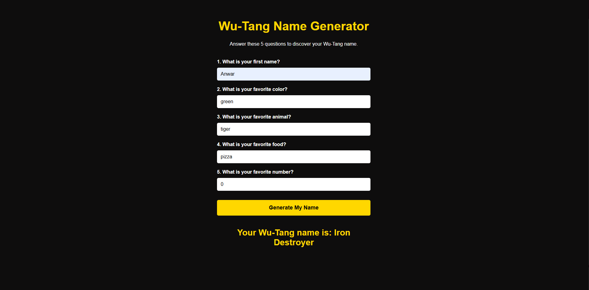

# Wu-Tang Name Generator

A full-stack web application that generates a random Wu-Tang-style name through an interactive five-question survey.

Built with HTML, CSS, JavaScript, and Node.js, the application uses a custom HTTP server and a REST-style API endpoint to generate and return randomized names.

## Live Demo

**[Try the Wu-Tang Name Generator](https://wu-tang-clan.onrender.com/)**

## Technologies


## Features

- Interactive five-question survey
- Generate randomized Wu-Tang-style names
- Custom Node.js HTTP server
- Backend API endpoint for name generation
- Asynchronous frontend-to-backend communication
- Display generated names without reloading the page
- Responsive, Wu-Tang-inspired interface
- Deployed as a Node.js web service on Render

## Screenshot



## How It Works

1. Enter your first name, favorite color, favorite animal, favorite food, and favorite number.
2. Click **Generate My Name**.
3. The frontend sends a request to the Node.js backend.
4. The `/api` endpoint randomly selects a first and last name from predefined lists.
5. The server returns the generated name as JSON.
6. JavaScript displays the name on the page.

**Note:** The current implementation generates names randomly. Survey answers do not determine the generated name.

## API Endpoint

### GET /api

Generates a random Wu-Tang-style name.

**Example request:**

```http
GET /api
```

**Example response:**

```json
{
  "wuTangName": "Iron Destroyer"
}
```

## Getting Started

### 1. Clone the Repository

```bash
git clone https://github.com/AnwarAlshohatee/wu-tang-clan.git
cd wu-tang-clan
```

### 2. Install Dependencies

Requires Node.js.

```bash
npm install
```

### 3. Start the Server

```bash
npm start
```

The application runs locally at:

```text
http://localhost:8000
```

Open this address in your browser to use the name generator.

## Project Structure

```text
wu-tang-clan/
├── css/
│   └── style.css
├── js/
│   └── main.js
├── index.html
├── server.js
├── package.json
├── package-lock.json
├── wutang.PNG
└── README.md
```

## Future Improvements

- Generate names based on survey responses
- Add more name combinations
- Allow users to regenerate names without repeating the survey
- Add a feature to copy or share generated names
- Improve input validation and accessibility

## Author

**Anwar Alshohatee**

[Portfolio](https://anwaralshohatee.netlify.app) | [LinkedIn](https://www.linkedin.com/in/anwaralshohatee/)
